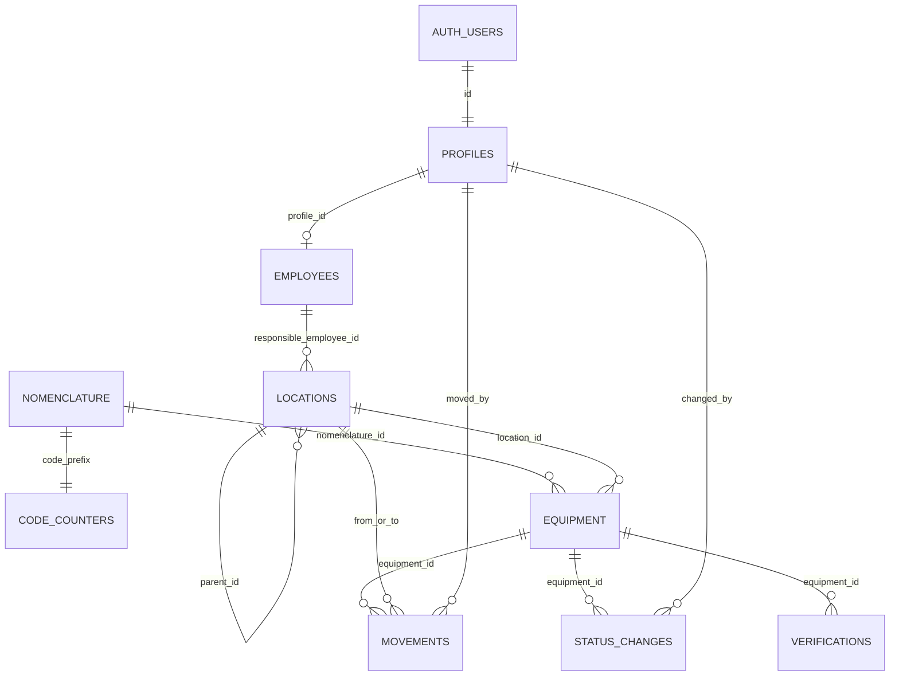

# Модель данных

Фактическая схема после этапа 4. Источник — `supabase/migrations/`. Журнал решений: [decisions.md](decisions.md).

Коды статусов в базе стабильные, подписи на экране русские:

| Код | Подпись |
| --- | --- |
| `in_work` | В работе |
| `on_verification` | На поверке |
| `in_repair` | В ремонте |
| `written_off` | Списано |
| `reserve` | Резерв |

Роли: `admin`, `editor`, `viewer`. Результат поверки: `passed` (годен), `failed` (не годен).

Общие правила, которые удерживает база:

- Единица не удаляется. Выбытие — статус `written_off`.
- Код выдаёт триггер. Значение с клиента затирается. После создания нельзя сменить `code` и `nomenclature_id`.
- Номер префикса только растёт. Счётчик с уже выданными номерами не удаляется и не уменьшается.
- Префикс номенклатуры — 2–8 символов `A–Z` и цифр, уникален. После появления единиц его не меняют. До этого смена префикса переносит строку `code_counters`.
- Ответственный места, если не задан, читается с ближайшего предка. В строке лежит только своё значение.
- Поля и журнал поверок — только у единиц с `nomenclature.requires_verification = true`.
- `moved_by` и `changed_by` — это `profiles` вошедшего пользователя (`auth.uid()`), подменить их вставкой нельзя.
- Архивное место нельзя назначить заново. Старые строки истории на него остаются.

У таблиц `profiles`, `employees`, `locations`, `nomenclature`, `equipment` есть `created_at` и `updated_at`. Последнее поле двигает триггер `set_updated_at`.

## profiles

Одна строка на пользователя `auth.users`. Триггер `profiles_on_auth_user_created` создаёт её при вставке в Auth с ролью `viewer`. Отдельная миграция добирает уже существующих пользователей и, если среди них есть `kb09062001@gmail.com`, ставит ему `admin`. Свою роль пользователь сменить не может, в том числе администратор.

| Поле | Тип | Ограничения |
| --- | --- | --- |
| `id` | uuid | PK, FK → `auth.users.id`, каскадное удаление |
| `full_name` | text | not null, не пустое |
| `role` | `app_role` | not null, по умолчанию `viewer` |
| `is_active` | boolean | not null, по умолчанию `true`. `false` — политик RLS не пускают |

## employees

Люди для поля «ответственный». Учётная запись не обязательна.

| Поле | Тип | Ограничения |
| --- | --- | --- |
| `id` | uuid | PK |
| `full_name` | text | not null |
| `position` | text | null |
| `phone` | text | null |
| `profile_id` | uuid | null, unique, FK → `profiles.id`, при удалении профиля обнуляется |
| `is_archived` | boolean | not null, по умолчанию `false` |

Удалить сотрудника, на которого ссылается `locations.responsible_employee_id`, нельзя: триггер просит архивировать карточку. Архивный сотрудник остаётся на уже указанных местах, но новым ответственным его назначить нельзя. Представление `employees_directory` добавляет имя связанного профиля и `location_count`.

## locations

Дерево произвольной глубины. Цикл в `parent_id` режет триггер `locations_prevent_cycle`.

| Поле | Тип | Ограничения |
| --- | --- | --- |
| `id` | uuid | PK |
| `parent_id` | uuid | null у корня, FK → `locations.id`, удаление родителя запрещено |
| `name` | text | not null |
| `kind` | text | not null. Свободная подпись: завод, цех, участок и дальше |
| `responsible_employee_id` | uuid | null, FK → `employees.id` |
| `is_archived` | boolean | not null, по умолчанию `false` |

Функции `location_full_path(id)` и `effective_responsible_employee_id(id)` считают путь (`Завод → Цех → Участок`) и ответственного. `location_responsible_source(id)` дополнительно возвращает узел, с которого взято значение. Представление `locations_with_path` отдаёт путь, эффективного сотрудника, имя узла-источника, флаг `responsible_is_inherited`, признак архива этого сотрудника и три счётчика: `equipment_count` (единицы в узле и во всём поддереве), `direct_equipment_count`, `child_count`. В строку места вычисленное имя не копируется.

Архивировать узел нельзя, пока в нём есть вложенные места или единицы с `equipment.location_id` на этот узел. История перемещений архив не блокирует. Новый узел и перенос не попадают внутрь архивного родителя. Перенос к другому родителю или в корень делает `move_location(location_id, new_parent_id)`: цикл («внутрь самого себя» или «внутрь вложенного узла») отвергается до записи. Функция не `security definer`, писать может только `admin`.

## nomenclature

| Поле | Тип | Ограничения |
| --- | --- | --- |
| `id` | uuid | PK |
| `code_prefix` | text | not null, unique, `^[A-Z0-9]{2,8}$` |
| `name` | text | not null |
| `manufacturer` | text | null |
| `model` | text | null |
| `category` | text | null |
| `requires_verification` | boolean | not null, по умолчанию `false` |
| `verification_interval_months` | integer | обязателен и больше нуля, только если флаг поверки включён, иначе null |
| `notes` | text | null |

Представление `nomenclature_with_counts` добавляет `equipment_count`.

## code_counters

| Поле | Тип | Ограничения |
| --- | --- | --- |
| `prefix` | text | PK, FK → `nomenclature.code_prefix`, каскад при смене префикса и удалении пустой номенклатуры |
| `last_number` | integer | not null, по умолчанию `0`, только увеличивается |

Строка счётчика появляется вместе с номенклатурой. Перед вставкой единицы триггер делает `INSERT ... ON CONFLICT DO UPDATE ... RETURNING` и пишет `code`. Номер меньше 1000 дополняется до трёх знаков (`KYOC-001`). С 1000 дополнения нет (`KYOC-1000`). Откат транзакции откатывает и номер: неудачная вставка номер не сжигает.

## equipment

| Поле | Тип | Ограничения |
| --- | --- | --- |
| `id` | uuid | PK |
| `nomenclature_id` | uuid | not null, FK → `nomenclature.id`, после создания не меняется |
| `code` | text | not null, unique, формат `ПРЕФИКС-NNN`, после создания не меняется |
| `serial_number` | text | null |
| `inventory_number` | text | null |
| `status` | `equipment_status` | not null, по умолчанию `in_work` |
| `location_id` | uuid | null, FK → `locations.id` |
| `last_verification_date` | date | null, только при флаге поверки |
| `next_verification_date` | date | null, только при флаге поверки |
| `notes` | text | null |

Представление `equipment_list` соединяет единицу с названием номенклатуры, полным путём места и ответственным этого места (`location_responsible_name`, флаг наследования и имя узла-источника).

При создании пишутся начальные строки в `movements` и `status_changes`. Дальше смена `location_id` (при любом статусе) добавляет перемещение, смена `status` — запись статуса. Комментарий передают функции `move_equipment(equipment_id, to_location_id, comment)` и `change_equipment_status(equipment_id, new_status, comment)`. Время записи — `clock_timestamp()`, чтобы два события одной транзакции не схлопывались в одну отметку.

Пакетные функции `move_equipment_bulk(equipment_ids, to_location_id, comment)` и `change_equipment_status_bulk(equipment_ids, new_status, comment)` делают то же самое для нескольких единиц в одной транзакции. Ошибка на любой единице откатывает весь пакет, история появляется только если пакет прошёл целиком. Повтор одного id в массиве считается один раз. Пустой список, пустой id и пакет больше 200 единиц отвергаются. Если место или статус у единицы не меняется, в тексте ошибки есть её код. Права те же: `editor` и `admin`. Функции не `security definer`, действует RLS.

## movements

| Поле | Тип | Ограничения |
| --- | --- | --- |
| `id` | uuid | PK |
| `equipment_id` | uuid | not null, FK → `equipment.id` |
| `from_location_id` | uuid | null, FK → `locations.id` |
| `to_location_id` | uuid | null, FK → `locations.id` |
| `moved_at` | timestamptz | not null |
| `moved_by` | uuid | not null, FK → `profiles.id`, всегда `auth.uid()` |
| `comment` | text | null |

Удалить строку нельзя. Уже записанные место, время и автора править нельзя, комментарий можно. Представление `movement_history` добавляет пути и имя профиля.

`location_ancestor_ids(location_id)` возвращает само место и предков до корня. Пустой массив, если места нет. Функция не `security definer`.

## status_changes

| Поле | Тип | Ограничения |
| --- | --- | --- |
| `id` | uuid | PK |
| `equipment_id` | uuid | not null, FK → `equipment.id` |
| `from_status` | `equipment_status` | null у первой записи |
| `to_status` | `equipment_status` | not null |
| `changed_at` | timestamptz | not null |
| `changed_by` | uuid | not null, FK → `profiles.id`, всегда `auth.uid()` |
| `comment` | text | null |

Те же запреты, что у перемещений: строка не удаляется, факты не переписываются. Представление `status_change_history` добавляет имя профиля.

## journal_events

Представление, не таблица. `security_invoker = true`. Склеивает `movements` и `status_changes` в одну ленту.

| Поле | Смысл |
| --- | --- |
| `event_kind` | `movement` или `status_change` |
| `occurred_at` | `moved_at` или `changed_at` |
| `equipment_code`, `nomenclature_id`, `nomenclature_name` | единица и модель |
| `actor_id`, `actor_name` | профиль, который выполнил действие |
| `from_path`, `to_path` | полный путь места, только у перемещения |
| `location_scope` | id места и предков «откуда» и «куда». Фильтр узла захватывает вложенные места |
| `from_status`, `to_status`, `status_scope` | только у смены статуса. `status_scope` — исходный и новый код, без NULL |

У перемещения `status_scope` пустой, у смены статуса `location_scope` пустой.

## equipment_status_counts

Представление, `security_invoker = true`. По одной строке на каждый код `equipment_status`, включая нулевое число единиц. Считает то, что вызывающему видно через RLS.

## verifications

| Поле | Тип | Ограничения |
| --- | --- | --- |
| `id` | uuid | PK |
| `equipment_id` | uuid | not null, FK → `equipment.id`, на другую единицу не переносится |
| `verified_at` | timestamptz | not null |
| `result` | `verification_result` | not null |
| `next_due_at` | date | null |
| `certificate_number` | text | null |
| `file_path` | text | null. Путь в Storage, бакет появится с разделом поверок |
| `comment` | text | null |

Вставка и правка пересчитывают `equipment.last_verification_date` и `next_verification_date` по самой поздней записи (`verified_at`). Запись без флага поверки у номенклатуры отклоняется. Удалить строку журнала нельзя.

## RLS

Хелпер `public.current_role()` — `security definer`, `search_path = public`. Для неактивного или чужого пользователя возвращает NULL. Вызывать нужно с схемой: имя без схемы в Postgres занято ключевым словом.

| Кто | Что может |
| --- | --- |
| `anon` | ничего |
| активный пользователь | читать все таблицы и представления |
| `editor`, `admin` | вставлять и менять `equipment`, `movements`, `status_changes`, `verifications` |
| `admin` | вставлять, менять и удалять `nomenclature`, `locations`, `employees`; менять `profiles` |
| никто из клиента | писать в `code_counters`; удалять единицу и строки истории |

`code_counters` обновляет только триггер выдачи кода (`security definer`). Триггерные функции и `backfill_profiles()` нельзя вызвать через RPC: `EXECUTE` снят с `anon` и `authenticated`. `current_role()`, `move_equipment`, `change_equipment_status`, `move_equipment_bulk`, `change_equipment_status_bulk`, `move_location`, `location_full_path`, `location_ancestor_ids`, `effective_responsible_employee_id` и `location_responsible_source` у `authenticated` остаются. Представления `journal_events` и `equipment_status_counts` читает `authenticated`, у `anon` выбора нет. У `anon` нет `EXECUTE` ни на одну функцию `public`, кроме объектов расширений: Supabase выдаёт это право роли напрямую, и `REVOKE` у `PUBLIC` его не снимает. У каждой новой функции этапа 4 `EXECUTE` явно снят с `anon` и `PUBLIC` и выдан `authenticated`. Триггеры архива мест и запрета удаления сотрудника через RPC не вызываются. Новые функции не `security definer`. Для роли `postgres` в схеме `public` умолчание больше не выдаёт `EXECUTE` роли `anon`.

## Связи

