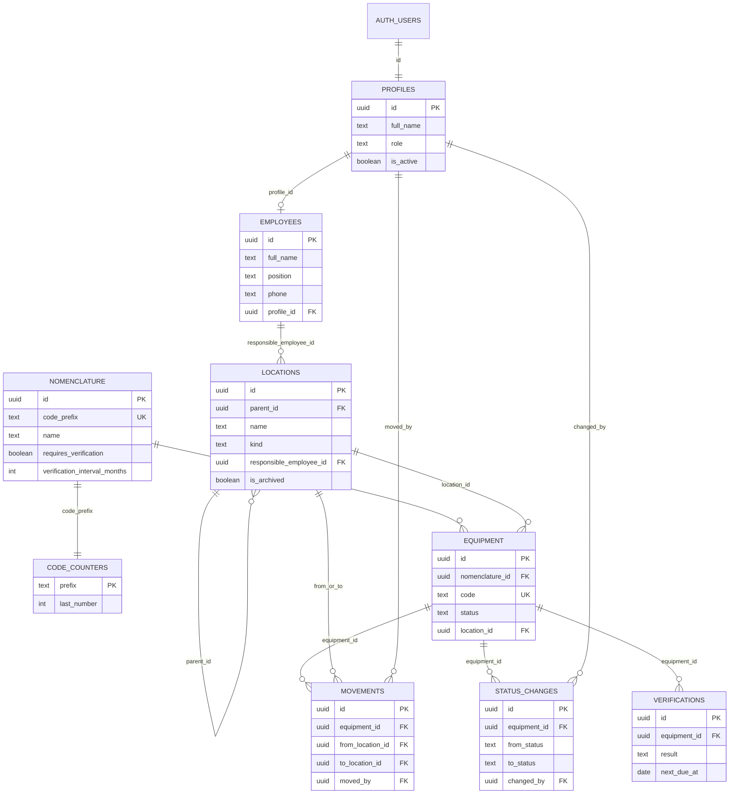

# Модель данных

Черновик таблиц для следующего этапа. Миграций здесь нет. Имена `equipment` и `employees` оставлены как в исходной схеме сущностей.

Журнал решений: [decisions.md](decisions.md).

Общие правила, которые схема должна удержать:

- Единицы не удаляются. Выбытие — статус `written_off`.
- Код единицы выдаёт база. Клиент его не придумывает. Номера префикса не переиспользуются.
- Ответственный места, если не задан, читается с ближайшего предка. В строке лежит только собственное значение.
- Поля и журнал поверок относятся только к единицам, у которых `nomenclature.requires_verification = true`.
- `moved_by` и `changed_by` ссылаются на `profiles` — пользователь, который выполнил действие.

## profiles

Учётная запись приложения. Одна строка на пользователя Supabase Auth. Через интерфейс регистрация не создаёт строки: их добавляет администратор.

| Поле | Тип | Ограничения |
| --- | --- | --- |
| `id` | uuid | PK, равен `auth.users.id` |
| `full_name` | text | not null |
| `role` | text | not null, `admin` \| `editor` \| `viewer` |
| `is_active` | boolean | not null, по умолчанию `true`. `false` — доступа нет |

## employees

Люди, которых можно назначить ответственными. Учётная запись не обязательна.

| Поле | Тип | Ограничения |
| --- | --- | --- |
| `id` | uuid | PK |
| `full_name` | text | not null |
| `position` | text | null |
| `phone` | text | null |
| `profile_id` | uuid | null, unique, FK → `profiles.id` |

## locations

Дерево мест произвольной глубины.

| Поле | Тип | Ограничения |
| --- | --- | --- |
| `id` | uuid | PK |
| `parent_id` | uuid | null у корня, FK → `locations.id` |
| `name` | text | not null |
| `kind` | text | not null. Подпись уровня: завод, цех, участок, помещение и любые следующие. Закрытого списка нет |
| `responsible_employee_id` | uuid | null, FK → `employees.id` |
| `is_archived` | boolean | not null, по умолчанию `false` |

Циклы в `parent_id` недопустимы. Архивное место не предлагается для новых размещений, но остаётся в истории.

## nomenclature

Тип или модель оборудования.

| Поле | Тип | Ограничения |
| --- | --- | --- |
| `id` | uuid | PK |
| `code_prefix` | text | not null, unique. Латиница в верхнем регистре, например `KYOC` |
| `name` | text | not null |
| `manufacturer` | text | null |
| `model` | text | null |
| `category` | text | null |
| `requires_verification` | boolean | not null, по умолчанию `false` |
| `verification_interval_months` | integer | null. Обязателен и больше нуля, если `requires_verification` |
| `notes` | text | null |

## code_counters

Счётчик выданных номеров на префикс.

| Поле | Тип | Ограничения |
| --- | --- | --- |
| `prefix` | text | PK, FK → `nomenclature.code_prefix` |
| `last_number` | integer | not null, по умолчанию `0`. Только увеличивается |

При вставке единицы одна транзакция блокирует строку счётчика, увеличивает `last_number` и записывает `equipment.code`. Если номер меньше 1000, он дополняется нулями до трёх знаков (`KYOC-001`). С 1000 дополнения нет (`KYOC-1000`). Уменьшать счётчик и занимать старый номер нельзя.

## equipment

Конкретная единица. Строка не удаляется.

| Поле | Тип | Ограничения |
| --- | --- | --- |
| `id` | uuid | PK |
| `nomenclature_id` | uuid | not null, FK → `nomenclature.id` |
| `code` | text | not null, unique. Формат `ПРЕФИКС-NNN` |
| `serial_number` | text | null |
| `inventory_number` | text | null |
| `status` | text | not null. `in_work`, `on_verification`, `in_repair`, `written_off`, `reserve` |
| `location_id` | uuid | null, FK → `locations.id`. Пусто, пока место не назначено |
| `last_verification_date` | date | null. Только при флаге поверки у номенклатуры |
| `next_verification_date` | date | null. Только при флаге поверки у номенклатуры |
| `notes` | text | null |
| `created_at` | timestamptz | not null |
| `updated_at` | timestamptz | not null |

## movements

История перемещений. Разрешена при любом статусе единицы.

| Поле | Тип | Ограничения |
| --- | --- | --- |
| `id` | uuid | PK |
| `equipment_id` | uuid | not null, FK → `equipment.id` |
| `from_location_id` | uuid | null, FK → `locations.id`. Пусто у первого размещения |
| `to_location_id` | uuid | null, FK → `locations.id` |
| `moved_at` | timestamptz | not null |
| `moved_by` | uuid | not null, FK → `profiles.id` |
| `comment` | text | null |

## status_changes

История смен статуса.

| Поле | Тип | Ограничения |
| --- | --- | --- |
| `id` | uuid | PK |
| `equipment_id` | uuid | not null, FK → `equipment.id` |
| `from_status` | text | null у первой установки статуса |
| `to_status` | text | not null, те же коды, что у `equipment.status` |
| `changed_at` | timestamptz | not null |
| `changed_by` | uuid | not null, FK → `profiles.id` |
| `comment` | text | null |

## verifications

Журнал поверок. Строки только у единиц с `requires_verification`.

| Поле | Тип | Ограничения |
| --- | --- | --- |
| `id` | uuid | PK |
| `equipment_id` | uuid | not null, FK → `equipment.id` |
| `verified_at` | timestamptz | not null |
| `result` | text | not null. `passed` — годен, `failed` — не годен |
| `next_due_at` | date | null |
| `certificate_number` | text | null |
| `file_path` | text | null. Путь файла свидетельства в Storage, бакет появится вместе с поверками |
| `comment` | text | null |

Запись в журнал обновляет `equipment.last_verification_date` и `equipment.next_verification_date`. Это правило следующего этапа, не текущего каркаса.

## Связи

